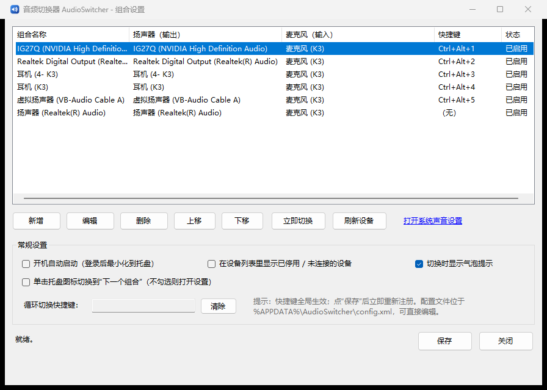

# 音频切换器 AudioSwitcher

Windows 11 上一键切换「扬声器输出 + 麦克风输入」组合的小工具。托盘常驻、全局快捷键、组合可视化配置。

- **单文件 exe**（约 76 KB），不需要安装任何运行库（Win10/11 自带 .NET Framework 4.8）
- **不需要管理员权限**
- 一键切换：按快捷键 / 点托盘图标 / 点托盘菜单
- 组合项自定义：每个组合可以指定「输出设备 + 输入设备」，输入或输出也可以留空表示「不更改」
- 快捷键自定义：在设置里点一下输入框，直接按组合键即可录制（如 `Ctrl+Alt+1`）
- 可选开机自启、切换气泡提示、单击托盘图标循环切换



## 下载

到 [Releases](https://github.com/wangzhenvvsd/AudioSwitcher/releases) 下载 **`AudioSwitcher.exe`**：

- **单文件绿色版**（约 76 KB）：下载后双击即用。不需要安装、不需要管理员权限、不需要额外运行库，也不写任何系统目录；配置与日志只在 `%APPDATA%\AudioSwitcher` 下。
- 想装到固定位置（开始菜单/桌面快捷方式、可选开机自启）：clone 本仓库后运行 `install.ps1`，会装到 `%LOCALAPPDATA%\Programs\AudioSwitcher`。

## 快速开始

直接双击运行：

```
dist\AudioSwitcher.exe
```

首次运行会自动按你当前的音频设备生成一组组合（每个输出设备一个，配当前麦克风，默认快捷键 `Ctrl+Alt+1` ~ `Ctrl+Alt+5`），并弹出设置窗口。

想装到固定位置（含开始菜单/桌面快捷方式、可选开机自启）：

```powershell
powershell -ExecutionPolicy Bypass -File install.ps1
# 或
powershell -ExecutionPolicy Bypass -File install.ps1 -StartWithWindows
```

安装位置：`%LOCALAPPDATA%\Programs\AudioSwitcher\AudioSwitcher.exe`

## 使用

运行后程序只出现在任务栏右下角托盘：

| 操作 | 效果 |
| --- | --- |
| 快捷键（如 `Ctrl+Alt+1`） | 切换到对应组合 |
| 右键托盘图标 | 菜单里列出所有组合，点一下即切换；顶部显示当前扬声器/麦克风 |
| 双击托盘图标 | 打开设置 |
| 单击托盘图标 | 默认打开设置（勾选「单击托盘图标切换到下一个组合」后改为循环切换） |

### 设置窗口

- **新增 / 编辑**：组合名称、扬声器（输出）、麦克风（输入）、快捷键、是否启用
- 设备下拉框第一项是「（不更改，保持系统当前设置）」——只想切扬声器、不想动麦克风时选它
- 旁边有「取当前」按钮，一键填入系统当前默认设备
- **上移 / 下移**：调整顺序（影响托盘菜单顺序）
- **立即切换**：不用保存也能试一下效果
- **打开系统声音设置**：打开 Windows 自带的声音设置页面
- **保存**：写配置并立刻重新注册快捷键（不保存直接关闭会提示）

快捷键规则：至少需要 `Ctrl` / `Alt` / `Shift` / `Win` 之一，`F1`~`F24` 可以单独使用；在输入框里按 `Backspace` / `Delete` 清除。`Win+...` 组合受系统占用影响较大，建议用 `Ctrl+Alt+数字`。

## 命令行（可选）

程序是 GUI 子系统，但支持命令行参数（用 `powershell` 调用时建议加 `| Out-Host` 或重定向）：

```
AudioSwitcher.exe --list            列出音频设备（--all 连未连接的也列）
AudioSwitcher.exe --status          显示当前默认设备 + 配置里的组合
AudioSwitcher.exe --switch 1        按序号切换组合（也可以写名称，支持模糊匹配）
AudioSwitcher.exe --selftest        自检每个快捷键能否注册（排查被其它程序占用）
AudioSwitcher.exe --set-output K3    直接把默认扬声器切成名字含 "K3" 的设备
AudioSwitcher.exe --set-input  K3    同上，麦克风
AudioSwitcher.exe --settings        启动并打开设置
AudioSwitcher.exe --tray            启动并最小化到托盘（默认行为）
```

## 配置文件

`%APPDATA%\AudioSwitcher\config.xml`（可直接编辑，改完在托盘菜单点「重新读取配置文件」）

```xml
<AudioSwitcherConfig>
  <Version>1</Version>
  <StartWithWindows>false</StartWithWindows>
  <ShowNotifications>true</ShowNotifications>
  <ShowInactiveDevices>false</ShowInactiveDevices>
  <TrayClickCycles>false</TrayClickCycles>
  <CycleHotkey></CycleHotkey>
  <Combos>
    <Combo Name="耳机 (K3)" Hotkey="Ctrl+Alt+4" Enabled="true">
      <OutputDeviceId>{0.0.0.00000000}.{...}</OutputDeviceId>
      <OutputDeviceName>耳机 (K3)</OutputDeviceName>
      <InputDeviceId>{0.0.1.00000000}.{...}</InputDeviceId>
      <InputDeviceName>麦克风 (K3)</InputDeviceName>
    </Combo>
  </Combos>
</AudioSwitcherConfig>
```

设备既按 ID 匹配，也会在 ID 失效时按名称模糊匹配，所以设备换 USB 口之后组合通常还能继续用。

日志：`%APPDATA%\AudioSwitcher\AudioSwitcher.log`（超过 512 KB 自动清空，用来查「快捷键没反应」）。

## 常见问题

**快捷键没反应？**
先跑 `AudioSwitcher.exe --selftest`：
- 显示 `[占用]` 说明该组合键被别的程序（或另一个本程序实例）注册了，换一个组合键；
- 显示 `[可用]` 说明注册没问题，检查是不是把组合设成了「已停用」，或看日志有没有「收到热键消息」。

**切换提示「设备未连接」？**
蓝牙耳机/未插的 USB 声卡在系统里会变成「未连接」状态，这时无法设为默认设备。设置里勾选「显示已停用/未连接的设备」可以看到它们的状态。

**杀毒软件/Defender 报未知程序？**
exe 是本机用系统自带编译器现场编译的（没有数字签名），首次运行 SmartScreen 可能提示，选择「仍要运行」即可；也建议把 `%LOCALAPPDATA%\Programs\AudioSwitcher` 或 exe 所在目录加进白名单。

**会改坏我的系统音频设置吗？**
只会调用系统接口设置「默认播放/录音设备」，等价于在「设置 → 系统 → 声音」里手选设备，不动驱动、不动注册表里的设备配置。原来的默认设备随时可以切回去。

## 实现说明

- 设备枚举：Core Audio `IMMDeviceEnumerator` / `IMMDevice` / `IPropertyStore`（`PKEY_Device_FriendlyName`）
- 设为默认设备：未公开的 `IPolicyConfig::SetDefaultEndpoint`，一次设置 `Console`/`Multimedia`/`Communications` 三个角色。
  本机 Win11 上 `CPolicyConfigClient` 不暴露该接口（`E_NOINTERFACE`），所以程序会自动回退到
  `CPolicyConfigVistaClient` + `IPolicyConfigVista`，两条通道都探测过，见 `tools/Probe.cs`
- 全局快捷键：`RegisterHotKey` + 隐藏消息窗口（`MOD_NOREPEAT`，跨进程占用冲突会提示）
- UI：WinForms（`.NET Framework 4.8`，系统 DPI 感知），配置：`XmlSerializer`

目录结构：

```
src/Native/ComInterfaces.cs    Core Audio + PolicyConfig 的 COM 互操作
src/Audio/AudioService.cs      设备枚举 / 默认设备读写 / 设备解析
src/Config/AppConfig.cs        配置模型、首次运行自动生成组合
src/Hotkeys/                   快捷键文本解析 + 隐藏热键窗口
src/UI/                        设置窗口、组合编辑窗口、快捷键录制输入框
src/TrayApp.cs                 托盘程序主逻辑
src/Program.cs                 入口 + 命令行
tools/                         图标生成器、探测/自检小工具（不参与主程序编译到 dist）
```

## 构建

Win11 自带 .NET Framework 4.8，用系统里的 `csc.exe` 直接编译，无需安装 SDK：

```powershell
powershell -ExecutionPolicy Bypass -File build.ps1
# 产物：dist\AudioSwitcher.exe
```

## 卸载

删除 `%LOCALAPPDATA%\Programs\AudioSwitcher`、开始菜单/桌面快捷方式，
以及注册表 `HKCU\Software\Microsoft\Windows\CurrentVersion\Run` 下的 `AudioSwitcher` 项（如果在程序里开过开机自启）。
配置和日志在 `%APPDATA%\AudioSwitcher`，可一并删除。
